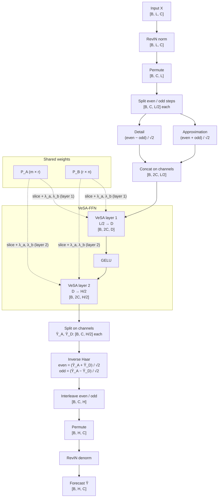
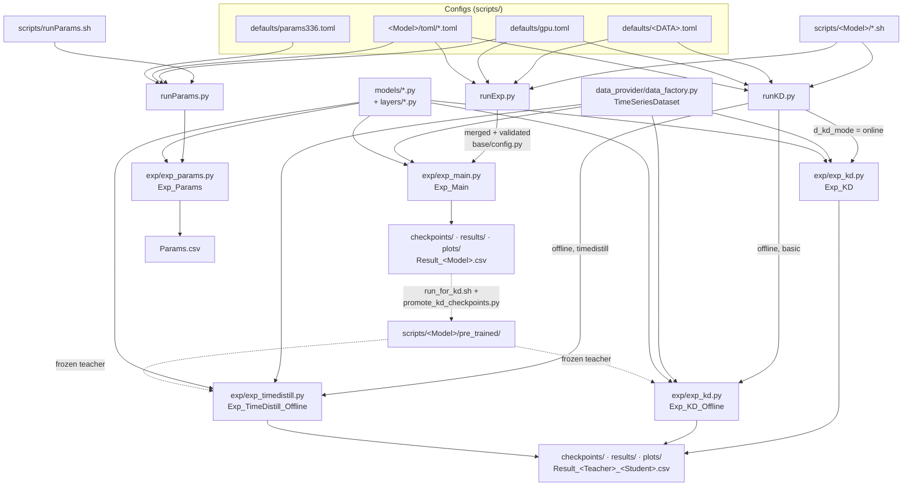

# VeSA-FFN: Vector-based Shared-matrix Adaptation FFN with Wavelet Decomposition

VeSA-FFN is a parameter-efficient model for long-term time series forecasting (LTSF), built for resource-constrained (edge) devices. It covers two deployment settings:

- **Local training, local inference:** VeSA-FFN trained on its own.
- **Remote training, local inference:** VeSA-FFN used as a student, distilled from a larger teacher (offline or online knowledge distillation).

## Model

Given an input `X ∈ R^{C×L}` (C channels, look-back L), VeSA-FFN forecasts `Ŷ ∈ R^{C×H}` (horizon H):

```
X ─ RevIN ─ Haar DWT ─► [X_A ; X_D]  (2C × L/2)
           ─ VeSA-FFN (L/2 → D → H/2) ─► [Ŷ_A ; Ŷ_D]  (2C × H/2)
           ─ inverse Haar DWT ─ RevIN⁻¹ ─► Ŷ  (C × H)
```

1. **RevIN** normalises each series.
2. **One-level Haar DWT** splits each series into approximation (low-frequency) and detail (high-frequency) coefficients. It also halves the length, so the FFN works on `L/2` inputs instead of `L`.
3. **VeSA-FFN** is a two-layer FFN with GELU (`L/2 → D → H/2`). Its weights are parametrised as

   ```
   W(l) = P_A[1:i_l, :] · diag(λ_a(l)) · P_B[:, 1:d_l] · diag(λ_b(l))
   ```

   - `P_A ∈ R^{m×r}` and `P_B ∈ R^{r×n}` are low-rank matrices of rank `r`, **shared** across both layers (and across channels). Each layer uses the slice that matches its own size.
   - `λ_a ∈ R^r` and `λ_b ∈ R^{d_l}` are **layer-specific** scaling vectors.
4. **Inverse Haar DWT** recombines the two halves into the full horizon, and RevIN restores the original scale.



Inside each VeSA layer, the input `[B, 2C, in]` is multiplied by `P_A[:in, :r]` scaled by `λ_a` to give `[B, 2C, r]`, then by `P_B[:r, :out]` scaled by `λ_b` to give `[B, 2C, out]`, and the bias is added.

The wavelet transforms add no trainable parameters, so all learnable weights sit in the VeSA-FFN. The idea comes from VeRA, but the shared matrices are trained, not frozen.

**Variants**

| Variant | `m_individual` | Scaling vectors | Used for |
|---|---|---|---|
| Generalised | `false` | One set shared by all channels | ETT datasets |
| Non-generalised | `true` | One set per decomposed channel | All other datasets |

With `L = 336`, `H = 192`, `D = 256` and `r = 16`, the VeSA weights are about 7.9× smaller than a vanilla FFN. On ETT, the generalised model has about 9.5K active parameters.

### Knowledge distillation

VeSA-FFN can be distilled from any supported teacher using a plain MSE loss:

```
Offline:  L = MSE(Y, Ŷ_S) + MSE(Ŷ_S, Ŷ_T_frozen)
Online:   L = MSE(Y, Ŷ_S) + MSE(Y, Ŷ_T) + MSE(Ŷ_S, Ŷ_T)
```

- **Offline:** the teacher is pre-trained and frozen. Its outputs are computed once and cached.
- **Online:** the teacher and student train together. The teacher trains alone during a warm-up (10 epochs by default) before the student starts.
- **TimeDistill** (offline only) is included as an alternative loss for comparison.

Only the student is used at test time.

## Repository layout

```
runExp.py            Standalone training and testing
runKD.py             Knowledge distillation (online / offline / TimeDistill)
runParams.py         Params, FLOPs, size and latency profiling
base/config.py       Config schema (pydantic) for every toml key
exp/                 Experiment loops: exp_main, exp_kd, exp_timedistill, exp_params
models/              Vesa (VeSA-FFN), FITS, DLinear, PatchTST, iTransformer, FrNet, FreqMoE, Chronos2, baselines
layers/              Shared layers (RevIN, attention, embeddings, PatchTST backbone)
data_provider/       Sliding-window dataset (70/10/20 split)
utils/               Metrics, LR schedules, early stopping, plotting
scripts/defaults/    Dataset, GPU and profiling configs
scripts/<Model>/     Run scripts and model configs for each model
```

### Repository flow



## Setup

```bash
pip install -r requirements.txt
```

Python 3.11+ is required (configs are read with `tomllib`).

### Datasets

Put the CSV files in `../dataset` (one level above the repo). You can change this with `d_root_path` in `scripts/defaults/<DATA>.toml`.

| Config | File | Channels |
|---|---|---|
| `ETTh1`, `ETTh2`, `ETTm1`, `ETTm2` | `ETTh1.csv`, … | 7 |
| `WTH` | `weather.csv` | 21 |
| `SOLTX` | `solar_TX.csv` | 56 |
| `SOLAL` | `solar_AL.csv` | 137 |
| `ELT` | `electricity.csv` | 321 |
| `METRLA` | `metr-la.csv` | 207 |
| `PEMSBAY` | `pems-bay.csv` | 325 |

Each CSV needs a `date` column first, followed by one column per channel.

## Configuration

Every run combines three or four toml files. Later files override earlier ones:

```
data toml [default]  <  gpu toml [gpu]  <  model toml [default]  <  model toml [[runs]]
```

- `d_*` keys hold data and training settings; `m_*` keys hold model settings. All keys are listed in [base/config.py](base/config.py).
- Each `[[runs]]` entry is one experiment (usually one prediction horizon). Each run is repeated for seeds 2021, 2022 and 2023.
- Set `d_use_gpu` and `d_gpu` in `scripts/defaults/gpu.toml`. If CUDA is not available, the run uses the CPU.

VeSA-FFN keys (`scripts/Vesa/toml/...`):

| Key | Meaning | Paper setting |
|---|---|---|
| `m_use_norm` | Use RevIN | `true` |
| `m_individual` | Non-generalised (per-channel scales) | `false` for ETT, `true` otherwise |
| `m_seq_dim` | FFN hidden dim `D` | `256` |
| `m_vesa_rank` | Shared rank `r` | `16` (model1) / `64` (model2) |
| `d_kd_mode` | `online` or `offline` (KD only) | |
| `d_kd_type` | `basic` or `timedistill` (KD only) | `basic` |
| `d_kd_teacher_warmup_epochs` | Teacher-only epochs in online KD | `10` |

`model1.toml` is the generalised config (ETT) and `model2.toml` is the non-generalised config (all other datasets).

## Running

Run all commands from the repository root.

### 1. Standalone VeSA-FFN

All datasets:

```bash
sh scripts/Vesa/run.sh
```

One dataset:

```bash
python -u runExp.py --data_config scripts/defaults/ETTh1.toml --gpu_config scripts/defaults/gpu.toml --model_config scripts/Vesa/toml/standalone/model1.toml
```

Add `--seed 2021` to run a single seed. Baselines are run the same way with `scripts/<Model>/run.sh`.

### 2. Offline knowledge distillation

1. Train each teacher once, using one seed:

   ```bash
   sh scripts/PatchTST/run_for_kd.sh
   ```

2. Copy its checkpoints to `scripts/<Model>/pre_trained/<Dataset>/pl<H>/`:

   ```bash
   python scripts/promote_kd_checkpoints.py --model PatchTST
   ```

3. Distil into VeSA-FFN. This runs every teacher with the basic loss, then with the TimeDistill loss:

   ```bash
   sh scripts/Vesa/run_offline.sh
   ```

Chronos2 does not need steps 1 and 2: it downloads its weights to `scripts/Chronos2/pre_trained/` the first time it runs.

A single offline run:

```bash
python -u runKD.py --data_config scripts/defaults/ETTh1.toml --gpu_config scripts/defaults/gpu.toml --teacher_config scripts/PatchTST/toml/model1.toml --student_config scripts/Vesa/toml/kd/offline/basic/model1.toml
```

### 3. Online knowledge distillation

```bash
sh scripts/Vesa/run_online.sh
```

Or use a single `runKD.py` call with `--student_config scripts/Vesa/toml/kd/online/model1.toml`. Chronos2 cannot be used as an online teacher.

### 4. Testing only

Set `d_is_training = 0` in the model toml and run the same command again. The checkpoint is loaded from `checkpoints/<setting>/checkpoint.pth`.

### 5. Efficiency profiling

```bash
sh scripts/runParams.sh
```

This writes total, trainable and active parameters, MACs/FLOPs, size (MB) and latency (ms) for each model to `Params.csv`. The grid it profiles is defined in `scripts/defaults/params336.toml`.

### Sanity checks

These scripts check that a model builds, runs and trains correctly before you start long experiments. They use random data only, so no dataset or GPU is needed.

```bash
python scripts/FITS/check_fits.py
python scripts/FreqMoE/check_freqmoe.py
```

`check_fits.py` builds FITS from each standalone config (`hourly`, `ett_15min`, `tenmin`, `fivemin`), with `m_individual` set to 0 and to 1, for horizons 96 and 720. For each setting it checks that:

- the forward pass on a random `[4, 336, 7]` batch returns one tensor of shape `[4, L + H, C]` with no NaN or Inf values;
- a backward pass gives a gradient to every parameter.

It prints the cut-off frequency and parameter count for each setting.

`check_freqmoe.py` builds FreqMoE from its model config for horizons 96 and 720. It checks that:

- the output is one tensor of shape `[4, H, C]` with no NaN or Inf values, in both train and eval mode;
- after a backward pass, `moe.band_boundaries` is the only parameter without a gradient.

It prints the parameter count, both as complex parameters and as real values (each complex parameter counts as 2).

Both scripts print `OK` when every check passes.

## Outputs

| Path | Content |
|---|---|
| `checkpoints/<setting>/` | Best checkpoint and fitted scaler |
| `results/<setting>/` | `preds.npy`, `trues.npy` (test set, stitched into one series) |
| `plots/<setting>/` | Forecast plots (when `d_plot_results = true`) |
| `Result_<Model>.csv` | Standalone MSE/MAE per run |
| `Result_<Teacher>_<Student>.csv` | KD MSE/MAE per run (`Result_TimeDistill_...` for TimeDistill) |

`<setting>` is the run name, for example `Vesa-ETTh1-ftM-sl336-pl96-seed2021`. To remove all generated outputs, run `sh cleaner.sh`.

## Evaluation protocol

- The data is split 70/10/20 (train/val/test).
- Training windows use a stride of 5. Validation and test windows use a stride equal to `H` (non-overlapping), and testing uses a batch size of 1.
- Training uses Adam with a learning rate of 1e-3. The rate stays fixed for 4 epochs, then is multiplied by 0.7 every 4 epochs (`d_lradj = "type7"`).
- Training runs for up to 100 epochs, with early stopping after 20 epochs without improvement.
- Results are reported as MSE and MAE, averaged over 3 seeds.

## License

See [LICENSE](LICENSE).
